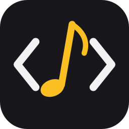

<p align="center"></p>

# 迪克的黑调

现场演示用的 VS Code 插件：提前把要「现场手写」的代码录好，台上**点一下空行、随便按键**，编辑器里只会一个字一个字打出正确的代码。台上不用点任何按钮、不用选片段。

更完整的说明见同目录的 `使用指南.txt`。

## 安装

在 VS Code 里按 `Cmd+Shift+P`（Windows 是 `Ctrl+Shift+P`），运行 **Extensions: Install from VSIX...**，选择 `dick-black-tune-x.x.x.vsix`，装完运行一次 **Developer: Reload Window**。

从源码打包：

```bash
npx @vscode/vsce package --no-dependencies
```

以前装过旧名字「演示打字机」（`zhizhong.demo-typer`）的话先卸载它；旧设置和工作区里的 `.demo-typer` 目录会自动搬到新名字下。

## 全部操作都在侧边栏面板里

装好后，左边活动栏多一个**键盘图标**，点开就是「迪克的黑调」面板，从上到下：

- **演示模式开关**：上台前打开，演示完关掉。正在打的时候显示进度；打到中文停下来时会提示要打什么。
- **当前文件**：
  - **● 录制选中代码**：在编辑器里选中一段代码，点这个按钮。代码被存起来，原位置留一个空行。按住 `Option`（Windows 是 `Alt`）拖选，可以一次选中好几段，每段各存一个。
  - **↺ 重置**：把已经打出来的代码删掉（打了一半、打乱了的也会清掉），回到演示前，马上可以再练。
  - **⤓ 全部填回**：把所有代码一次性填回文件（想运行完整程序时用）。
  - 文件名右边的 **⋯**：**恢复原文件**（回到第一次录制之前，一字不差）、**打开配置文件**、**删除全部片段**（可以选择先恢复原文件）。
  - 每一段代码一张卡片，编号的颜色表示状态（灰：待打，蓝：正在打，橙：打了一半，绿：已在文件里）。卡片上常用的是 **定位**、**预览**、**填入 / 清空**；右边的 **⋯** 里是 **改名**、**编辑代码**、**上移 / 下移**、**删除**。
- **其它文件**：这个工作区里其它演示文件，点「打开」直接打开。
- **打字设置**（点开）：每次按键出几个字、字与字的间隔、是否弹出代码补全（以及选补全前的停顿、一下补完的频率）、代码里的中文怎么打。模拟输入法的候选条不跟着 VS Code 缩放变大变小。
- **快捷键**（点开）：列出每个操作当前的快捷键（开关演示模式、停止正在打的这一段、录制、重置、全部填回、恢复原文件、删除全部片段）。点「修改 / 设置」直接打开 VS Code 的键盘快捷方式，双击那一行、按下想要的组合键、回车，面板里自动更新。
- **使用帮助**（点开）：台上怎么用、怎么彩排。

快捷键还在（`Cmd+Option+D` 开关演示模式），但不用也完全可以。

## 台上演示

1. 上台前在面板里打开「演示模式」。
2. 讲到写代码时，**用鼠标点一下要写代码的那个空行**，开始随便敲键盘。插件按这个空行上下的代码认出该打哪一段，一个字一个字打出来。
3. 一段打完后，继续敲也不会多出字。**点下一个空行**，接着敲，就是下一段。顺序随意。
4. 这个文件的片段全部打完后，键盘自动恢复正常，可以正常改代码、运行程序。

台上可以把侧边栏收起来，观众看不到面板，不影响使用。

- 打字像真人：多数时候一键一个字，偶尔连出两个；字与字的间隔随机浮动，整体快慢也会慢慢变化，单词之间偶尔停顿一下。按得慢字就出得慢，手一停字就停。
- 和真实 IDE 一样：打单词时会弹出编辑器自己的**代码补全列表**并跟着过滤，打「.」会弹出成员列表；长单词有时会停顿一下、像按 Tab 选中补全那样一下补完；打「函数名(」时弹出参数提示（需要装了 Python / Go 语言插件）。打左括号、左引号时右边自动补上，换行时缩进一起出现。补全效果可以在面板「打字节奏」里关掉。
- **打到中文时会停下来，交给你用真的输入法打**：光标处出现灰色提示文字（要打的内容），状态栏和面板也会提示。切到中文输入法（如 `Ctrl+空格` 或 `Caps Lock`）照着打，打完**切回英文再按键**，后面的代码才接着打出来（中文打完不切回英文，插件会一直等着）。打错字、记错内容、多打或少打都没关系：切回英文按第一下时，这一行会自动纠正成正确内容；每段打完还会整行再核对一遍。不想停下来的话，面板「打字设置」里的「代码里的中文」还有两个选项：**模拟拼音输入法**（按键时先打出带下划线的拼音如 `ce'shi'ji`、弹出仿系统样式的候选条（按真实词频列出 7 个候选，如「测试 侧室 侧视 测时…」），再上屏成汉字；候选条样式可选 macOS 或 Windows 10 微软拼音（默认跟随系统），颜色可选跟随系统/浅色/深色）和**插件直接打出**。
- 点到连续几行空行里的任何一行都行，代码会落到原来的位置，空行间距和原文件一样。
- 中途手碰到方向键或鼠标也没关系，代码始终在开始的位置接着打。
- 想停一下就按 `Esc` 暂停（底栏数字前出现暂停图标），已经打出来的留着。光标没动的话再按键就接着打；也可以点到别处正常打字，之后点回原来停下的位置再按键，还能接上。
- 关掉了演示模式、重新加载了窗口、或者中间先打了别的片段：点回打了一半的那一段附近（它所在的行或下面的空行）再按键，会从上次打到的地方接着打，不会另起一份；内容被打乱了的会先清掉再从头打。
- 不在空行上、或者文件里没有录过片段时，按键就是正常打字。

## 片段存在哪里、怎么换电脑

录制的内容存在各工作区的 `.dick-black-tune/snippets.json`（录制前的原文件备份在 `.dick-black-tune/backups/`）。换到另一台电脑演示时，装好同一个 `.vsix`，把这个 `snippets.json` 复制到那台电脑上同一个工作区的 `.dick-black-tune/` 里即可。

## 注意

- **先切换到英文输入法。** 中文输入法下按键会先进拼音候选框，插件收不到。只有打到中文、插件停下来等你时才切中文。
- 和 Vim 这类也接管键盘输入的插件冲突，演示时先禁用它们。
- 这个插件只在 VS Code 里有效，PyCharm 里用不了。
- 「重置」会删掉已经打出来的代码；打了一半、或被打乱的（卡片上显示「打了一半」）也会按上下文认出来一起清掉。如果录制位置上下的代码被改过、认不出来，就用「恢复原文件」。

## 发布到插件市场

仓库已配置 GitHub Actions 受信任发布（`.github/workflows/publish.yml`）。先把 `package.json` 里的 `version` 改成新版本并提交，再推送同名标签，就会自动发布到插件市场，并创建 GitHub Release、附上 `.vsix`：

```bash
git tag v0.18.2
git push origin v0.18.2
```

## 许可

MIT，见 `LICENSE`。内置的第三方数据：`lib/pinyin-pro.js`（MIT，见 `lib/pinyin-pro.LICENSE`）；`lib/ime-dict.json` 由 jieba 词频词典（MIT）生成，见 `lib/ime-dict.NOTICE`。
